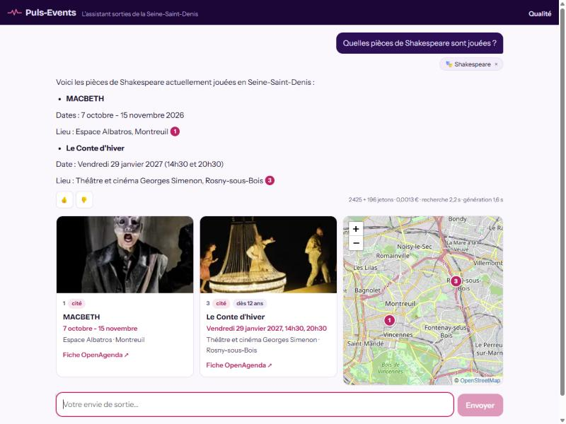

# POC RAG — Assistant de recommandation d'évènements culturels

Proof of Concept d'un système **Retrieval-Augmented Generation** pour Puls-Events : un chatbot qui
recommande des évènements culturels en s'appuyant sur les données publiques **OpenAgenda**, une base
vectorielle **Faiss** et le modèle **Mistral**, orchestrés par **LangChain**.

Projet 11 du parcours Data Engineer OpenClassrooms — [énoncé complet](consigne.md).

---

## 📊 Où en est le projet ?

**Avancement : 12 / 12** ▓▓▓▓▓▓▓▓▓▓▓▓ 100 %

| # | Étape | Ce qui est produit | Statut |
| :-: | --- | --- | :-: |
| 0 | Cadrage & documentation | `consigne.md`, `README.md`, dépôt git | ✅ Fait |
| 1 | Environnement de travail | `requirements.txt`, `.venv`, `check_env.py` | ✅ Fait |
| 2 | Extraction OpenAgenda | `src/extract.py`, données brutes | ✅ Fait |
| 3 | Pré-processing & nettoyage | `src/preprocess.py`, dataset propre | ✅ Fait |
| 4 | Tests unitaires + pipeline CI | `tests/`, GitHub Actions | ✅ Fait |
| 5 | Chunking, embeddings & index Faiss | `src/build_index.py`, index Faiss | ✅ Fait |
| 6 | Chaîne RAG LangChain + Mistral | `src/rag.py` | ✅ Fait |
| 7 | Jeu de test annoté & évaluation | `data/qa_test.json`, `src/evaluate.py` | ✅ Fait |
| 8 | Démo live (chatbot en ligne de commande) | `src/chat.py` | ✅ Fait |
| 9 | Rapport technique (5–10 pages) | `livrables/rapport_technique.pdf` | ✅ Fait |
| 10 | Présentation (10–15 slides) | `livrables/presentation.pptx` | ✅ Fait |
| 11 | README final & packaging des livrables | zip de dépôt OpenClassrooms | ✅ Fait |

**Légende :** ✅ Fait · 🟡 En cours · ⬜ À faire

Les étapes sont menées **dans l'ordre**, une à la fois.

> Le détail des étapes et les critères de validation de chacune sont dans `conv.md` (fichier local,
> non versionné).

---

## 🎯 Objectifs

Les trois compétences évaluées par OpenClassrooms :

1. **Configurer l'environnement de travail** nécessaire à l'exploitation des données.
2. **Mettre en place un processus de nettoyage** afin d'améliorer la qualité des données.
3. **Identifier ou créer un modèle d'apprentissage** adapté aux contraintes et besoins métiers.

Contraintes imposées par l'énoncé :

- Données issues de l'**API OpenAgenda**, limitées à un périmètre géographique et à des évènements
  de **moins d'un an**. Périmètre retenu : la **Seine-Saint-Denis (93)**, soit **4 569 évènements**
  démarrant dans les douze derniers mois ou à venir, **2 295** après nettoyage — dont 2 146 ateliers
  d'agences France Travail écartés, qui ne sont pas des évènements culturels.
- Base vectorielle **reconstructible sur demande** (scripts de pré-processing et de vectorisation).
- Pas d'historique de conversation dans le POC.

---

## 🧱 Stack technique

| Brique | Outil | Pourquoi |
| --- | --- | --- |
| Langage | Python 3 | Imposé |
| Environnement | `venv` + `requirements.txt` | Imposé (venv ou conda) |
| Source de données | API OpenAgenda | Imposé |
| Manipulation de données | pandas | Recommandé par l'énoncé |
| Embeddings | `mistralai/mistral-embed-2312` | Imposé (Mistral) |
| Génération | modèle de chat Mistral | Imposé (Mistral) |
| Accès aux modèles | OpenRouter | Voir note ci-dessous |
| Base vectorielle | Faiss (`faiss-cpu`) | Imposé |
| Orchestration RAG | LangChain | Imposé |
| Tests | pytest + GitHub Actions | Tests « intégrés sous forme de pipeline » |

Rien d'autre dans la version déposée : ni API web, ni Docker, ni interface graphique — l'énoncé ne
les demande pas. La V2 ajoute une API et une interface web, et seulement elles (voir plus bas).

> **Note sur l'accès aux modèles.** Les modèles utilisés sont bien ceux de Mistral, comme l'impose
> l'énoncé, mais ils sont appelés via OpenRouter plutôt que par une clé Mistral directe. OpenRouter
> exposant une API compatible OpenAI, le code utilise `langchain-openai` avec un `base_url`
> personnalisé. Repasser sur l'API Mistral native ne demande que de changer ce `base_url` et le nom
> des modèles — c'est la recommandation faite pour la version de production.

---

## 🚀 Reproduire le projet

Python 3.11 ou 3.12 (Faiss n'est pas encore packagé pour les toutes dernières versions).

```bash
git clone <url-du-depot> && cd concevoir-et-deployer-un-systeme-rag
python -m venv .venv
.venv\Scripts\activate          # Windows — sous Linux/macOS : source .venv/bin/activate
pip install -r requirements.txt
python check_env.py               # doit afficher les 8 versions sans erreur
```

Puis copier `.env.example` en `.env` et y renseigner la clé OpenRouter :

```bash
cp .env.example .env
```

Les données et l'index ne sont pas versionnés : on les reconstruit, depuis la racine du dépôt, dans
l'ordre (quelques minutes, environ 0,10 $ d'appels d'embeddings) :

```bash
python src/extract.py       # API OpenAgenda -> data/raw/
python src/preprocess.py    # nettoyage -> data/processed/
python src/build_index.py   # chunks + embeddings Mistral -> data/faiss_index/
pytest                      # contrôles de qualité sur le dataset produit
```

`preprocess.py` affiche en fin d'exécution le nombre d'évènements en entrée, ceux écartés par chaque
règle de nettoyage et le nombre en sortie.

Le système est alors prêt :

```bash
python src/chat.py          # démo : chatbot en ligne de commande
python src/evaluate.py      # score sur le jeu de test annoté
```

Le nombre d'évènements varie selon le jour de l'extraction : les chiffres de ce README sont ceux de
l'extraction du 25 septembre 2026.

---

## 📁 Structure des fichiers

```
.
├── consigne.md          # énoncé OpenClassrooms intégral
├── README.md            # ce fichier
├── CLAUDE.md            # règles de travail pour l'assistant
├── requirements.txt     # dépendances épinglées
├── .env.example         # variable d'environnement attendue (clé OpenRouter)
├── check_env.py         # vérifie que les bibliothèques sont installées
├── src/
│   ├── extract.py       # extraction des évènements OpenAgenda (Seine-Saint-Denis)
│   ├── preprocess.py    # nettoyage et structuration du dataset
│   ├── build_index.py   # chunking, vectorisation Mistral et index Faiss
│   ├── rag.py           # chaîne RAG : recherche Faiss + réponse Mistral
│   ├── chat.py          # démo live : chatbot en ligne de commande
│   └── evaluate.py      # évaluation sur le jeu de test annoté (juge Mistral)
├── api/
│   └── main.py          # V2 : API FastAPI, réponse en flux SSE avec sources et citations
├── web/                 # V2 : interface Next.js (app/, components/, lib/, tests/)
├── demo.ps1             # V2 : lance l'API puis l'interface web
├── tests/
│   ├── test_data_quality.py  # contrôles de qualité du dataset
│   └── test_api.py      # V2 : contrôles de l'API, sans réseau
├── pytest.ini           # rend src/ importable par les tests
├── .github/workflows/
│   └── tests.yml        # pipeline CI : pytest à chaque push
├── livrables/
│   ├── rapport_technique.md   # rapport technique, source Markdown
│   ├── rapport_technique.pdf  # rapport technique, 9 pages
│   ├── presentation.pptx      # présentation de soutenance, 12 slides
│   └── generer_presentation.py  # régénère la présentation (pip install python-pptx)
└── data/
    ├── qa_test.json     # jeu de test annoté : 20 questions / réponses attendues (22 en V2)
    ├── evaluation.csv   # résultats de la dernière évaluation, question par question
    ├── evaluation_v1.csv  # V2 : évaluation de la chaîne du lot 1, base de comparaison
    ├── evaluation_v2.csv  # V2 : évaluation après le lot 2 (recherche hybride, filtres)
    ├── raw/             # réponses brutes de l'API          ┐
    ├── processed/       # dataset propre, prêt à indexer     ├ non versionnés,
    └── faiss_index/     # index vectoriel + métadonnées      ┘ reconstruits par les scripts
```

---

## 🔍 La base vectorielle

`build_index.py` reconstruit l'index de bout en bout à chaque exécution — c'est la contrainte
« base vectorielle reconstructible sur demande » de l'énoncé. Rien n'est versionné : l'index se
régénère à partir de `data/processed/` en quelques minutes, pour environ **0,10 $** d'appels API.

| Choix | Ce qui est fait | Pourquoi |
| --- | --- | --- |
| Texte vectorisé | titre + mots-clés + lieu + ville + dates + description | sans le lieu dans le vecteur, le même spectacle à Montreuil et à Bobigny est indiscernable en recherche sémantique |
| Découpage | 1 000 caractères, recouvrement de 100 | 74 % des évènements tiennent en un seul chunk ; seules les longues programmations sont coupées |
| Embeddings | `mistralai/mistral-embed-2312`, 1024 dimensions, par lots de 50 | modèle imposé par l'énoncé, appelé via OpenRouter |
| Index | `IndexFlatL2`, le défaut de LangChain | recherche exacte, aucun paramètre à régler ; `IVF` et `HNSW` échangent du rappel contre de la vitesse, ce qui n'a d'intérêt qu'à partir de centaines de milliers de vecteurs |

**2 295 évènements → 3 860 chunks → 3 860 vecteurs**, soit 16 Mo d'index et 4,5 Mo de métadonnées.
Les métadonnées gardées à côté de chaque vecteur sont celles qu'exige l'énoncé (dates, lieux,
descriptions), plus le `uid` qui relie un chunk à son évènement et le lien OpenAgenda.

Deux détails qui se justifient à l'oral :

- les vecteurs Mistral sont **normés** (norme = 1), donc la distance L2 classe exactement comme le
  cosinus — le choix `IndexFlatL2` n'introduit aucun biais par rapport à `IndexFlatIP` ;
- `OpenAIEmbeddings` compte par défaut les tokens avec `tiktoken` et envoie des identifiants de
  tokens OpenAI à la place du texte, ce que l'endpoint Mistral refuse : d'où le
  `check_embedding_ctx_length=False` dans le script.

---

## 💬 La chaîne RAG

```bash
python src/rag.py "Quels concerts de jazz sont prévus ?"
```

`rag.py` affiche la réponse, puis les évènements récupérés dans l'index (titre, date, lieu).

| Choix | Ce qui est fait | Pourquoi |
| --- | --- | --- |
| Modèle de génération | `mistralai/mistral-large-2512`, `temperature=0` | servi directement par Mistral sur OpenRouter, pour environ 0,002 $ par question ; `mistral-small-2603`, moins cher, était saturé (erreurs 429 en série) au moment des tests |
| Évènements passés | filtre `date_fin ≥ aujourd'hui` à la recherche | l'index garde un an d'historique comme le demande l'énoncé, mais seuls 276 évènements sur 2 295 sont encore d'actualité ; demander au modèle d'ignorer les dates passées ne marchait pas, filtrer avant lui est déterministe |
| Nombre de chunks (`k`) | 10 | à 5, des concerts de jazz pourtant présents dans l'index n'étaient pas remontés ; 10 chunks restent courts (environ 3 000 tokens) et le modèle écarte ceux qui ne répondent pas |
| Hallucinations | consigne système : répondre uniquement à partir des évènements fournis, et dire franchement quand aucun ne convient | une question hors corpus (« un match du PSG au Parc des Princes ? ») obtient bien un « non » plutôt qu'une invention |

La date du jour est donnée au modèle, et chaque chunk est préfixé de sa date de début complète : les
dates affichées par OpenAgenda (« Samedi 3 octobre ») n'ont pas d'année. Pas d'historique de
conversation : chaque question est traitée seule, comme le permet l'énoncé.

La recherche passe par la chaîne LangChain elle-même : `index.as_retriever(...)` récupère les
chunks, puis le prompt et Mistral génèrent la réponse, et la chaîne renvoie la réponse avec ses
sources pour que la démo puisse les afficher.

**Limite observée :** la recherche est le maillon faible, pas la génération. La recherche purement
sémantique capte mal un mot-clé précis : pour « Quels concerts de jazz sont prévus en
Seine-Saint-Denis ? », les concerts de jazz à venir n'arrivent qu'aux rangs 44 et 47, derrière les
évènements dont le texte contient « Seine-Saint-Denis » — et le modèle répond alors, à tort, qu'il
n'y en a pas. L'évaluation ci-dessous le mesure.

---

## 🎤 La démo

```bash
python src/chat.py
```

Un chatbot en ligne de commande, comme le demande l'énoncé (« démo live depuis l'environnement
local ») : on tape une question, il affiche la réponse puis les évènements récupérés dans l'index
(titre, dates, lieu, ville). `q` pour quitter. Afficher les sources prouve que la réponse vient de
l'index et non de la mémoire du modèle.

Le pool Mistral partagé d'OpenRouter renvoie parfois des erreurs 429 en rafale : la chaîne retente
jusqu'à six fois avant d'abandonner.

---

## 📏 L'évaluation

```bash
python src/evaluate.py
```

**Le jeu de test** (`data/qa_test.json`) : 20 questions annotées à la main à partir des évènements
réellement présents dans l'index — 8 par thème, 5 par lieu, 4 par date, 3 hors corpus pour vérifier
que le système n'invente rien. Chaque paire donne la réponse attendue et les `uid` des évènements
qui doivent être retrouvés.

**La mesure.** Le critère de l'énoncé — *« même sens et mêmes informations que la réponse
annotée »* — est appliqué par un **juge Mistral** (LLM-as-a-judge, `temperature=0`), qui rend
CORRECT ou INCORRECT avec une justification. Les alternatives ont été écartées : la comparaison
exacte ne tolère aucune reformulation, le recouvrement de mots-clés ne sait pas lire un « non », et
la similarité d'embeddings mesure la proximité du sujet, pas l'exactitude d'une date. En parallèle,
sans LLM, le script mesure le **rappel de la recherche** : combien d'évènements attendus figurent
dans les 10 chunks récupérés. C'est ce qui permet de savoir si une erreur vient de la recherche ou
de la génération.

| Type | Réponses correctes |
| --- | :-: |
| Thème | 4 / 8 |
| Lieu | 2 / 5 |
| Date | 1 / 4 |
| Hors corpus | 2 / 3 |
| **Total** | **9 / 20 (45 %)** |

Rappel moyen de la recherche : **52 %** sur les 17 questions qui attendent des évènements.

Ce qu'on en tire :

- **La recherche est le maillon faible.** Sur les 11 réponses incorrectes, 10 ont une recherche qui
  n'a pas remonté tous les évènements attendus. Quand la recherche les trouve tous (7 questions),
  la réponse est correcte 6 fois sur 7 après relecture.
- **Le problème du jazz est confirmé et expliqué.** Les deux concerts de jazz attendus sortent aux
  rangs 114 et 388 avec « en Seine-Saint-Denis » dans la question, et encore aux rangs 100 et 181
  avec « Où écouter du jazz ? ». Le mot « jazz » n'est que dans leurs mots-clés, pas dans leur
  description : leur vecteur parle d'autre chose. Une recherche hybride (mots-clés + sémantique) est
  la recommandation pour la version finale.
- **Les questions par date échouent** : un vecteur ne sait pas ce qu'est « le 13 décembre ». Un
  filtre sur les métadonnées de date, comme celui déjà utilisé pour les évènements passés, y répondrait.
- **Une hallucination** (question 17) : le modèle invente une tournée « potentiellement en
  Seine-Saint-Denis » à partir d'un fragment de description. La consigne système ne suffit pas à
  l'empêcher quand le contexte récupéré est hors sujet.

**Honnêteté de la mesure.** Les 20 verdicts du juge ont été relus à la main (la réponse générée est
gardée dans `data/evaluation.csv` pour ça) : accord sur **18 / 20**. Le juge est trop sévère sur la
question météo (l'assistant refuse bien, puis suggère un évènement) et trop indulgent sur les
expositions du musée Paul-Éluard (un titre manque) — les deux erreurs se compensent et le score
humain est aussi de 9 / 20. Un modèle Mistral qui juge un modèle Mistral est un biais connu ; la
relecture humaine est ce qui le contrôle. Le verdict peut aussi varier d'une exécution à l'autre
malgré `temperature=0`.

**Le jeu de test vieillit.** La chaîne ne recommande que les évènements à venir : les réponses
attendues ne citent que des évènements à partir du 31 octobre 2026, et le jeu est valable jusqu'au
30 octobre. En production, c'est le premier indicateur de dérive à surveiller — un corpus qui se
renouvelle impose de ré-annoter régulièrement le jeu de test.

---

## ✅ Tests

```bash
pytest
```

`tests/test_data_quality.py` vérifie ce qui partira dans la base vectorielle : périmètre
Seine-Saint-Denis, évènements de moins d'un an, absence de doublons, champs indispensables
renseignés. Chaque contrôle tourne deux fois — sur un échantillon de sept évènements construit dans
le fichier de test, puis sur `data/processed/` s'il a été généré.

Ce doublon n'est pas décoratif : l'échantillon rend les tests exécutables partout, y compris dans la
CI qui n'a ni clé API ni données extraites, tandis que le passage sur le dataset réel est le seul à
prouver que les évènements réellement indexés respectent les règles. Quand le dataset est absent, ces
quatre tests sont marqués « skipped » plutôt que faussement verts.

Le pipeline `.github/workflows/tests.yml` installe `requirements.txt` et lance `pytest` à chaque
push — il vérifie donc aussi que l'environnement se réinstalle proprement sur une machine neuve.

---

## 🌐 V2 : l'application web

La version déposée le 25 septembre 2026 est figée sous le tag `depot-openclassrooms-2026-09-25`. La
V2 habille la même chaîne RAG d'une application web, sans changer ce qu'elle cherche ni comment elle
répond : `src/chat.py` et `src/evaluate.py` marchent toujours. Ce qui est ajouté, et pourquoi, est
listé en section 8 de [consigne.md](consigne.md).

```
navigateur ──▶ web/ (Next.js, :3000) ──/api/*──▶ api/ (FastAPI, :8000) ──▶ src/rag.py ──▶ Faiss + Mistral
```

| Brique | Ce qu'elle fait |
| --- | --- |
| `src/rag.py` | numérote les évènements du contexte `[1]`, `[2]`… et demande au modèle de les citer par ce numéro |
| `api/main.py` | `POST /api/chat` en flux SSE : les sources dès que Faiss a répondu, puis le texte au fil de l'eau, puis les citations vérifiées (un `[n]` sans évènement est signalé). `GET /api/evenements/{uid}`, `GET /api/sante` |
| `web/` | Next.js 15, React 19, TypeScript. Chat en streaming, citations cliquables qui mènent à la carte de l'évènement, cartes avec image, dates, lieu et lien OpenAgenda. Mobile d'abord, mode sombre |



Les cinq questions de la démo passent dans le navigateur avec les mêmes évènements que
`src/chat.py` (23/10/2026). Les sources arrivent en une demi-seconde, avant le texte (environ 3 s
pour le premier mot, 5 s pour la réponse entière). Autres captures dans `livrables/captures/` :
accueil en mode sombre, sources affichées pendant la rédaction, réponse sur téléphone (375 px).

Pas d'historique envoyé au modèle, comme dans le POC : les échanges restent affichés, mais chaque
question part seule. Une erreur 429 d'OpenRouter est retentée par l'API, et l'interface affiche
« le service Mistral est saturé, nouvel essai… » au lieu de planter.

**Lancer la démo** (Windows, depuis la racine du dépôt, index déjà construit) :

```bash
cd web && npm install && cd ..
```

```bash
powershell -File demo.ps1
```

`demo.ps1` ouvre l'API dans sa propre fenêtre puis l'interface ; ouvrir http://127.0.0.1:3000. À la
main, deux terminaux : `python -m uvicorn main:app --app-dir api --port 8000` à la racine, et
`npm run dev` dans `web/`.

**Tests.** `pytest` couvre aussi l'API (`tests/test_api.py`) sans réseau : l'index et le modèle Mistral
sont remplacés par des faux, ce qui permet à la CI de vérifier l'ordre du flux, les citations et les
nouveaux essais sur 429. Côté web, `npm test` dans `web/` vérifie la lecture du flux SSE, le
relevé des citations et le libellé des puces de filtres ; la CI lance aussi `npm run build`.

> L'extraction du 25/09/2026 est conservée, mais `preprocess.py` relancé le 23/10/2026 écarte
> 178 évènements de plus, qui ont maintenant commencé il y a plus d'un an : **2 120 évènements,
> 3 558 vecteurs**. Les 20 évènements du jeu de test sont tous encore là.

### Lot 2 : de meilleures réponses

L'évaluation du POC désignait la recherche comme maillon faible (« jazz » à 0/2, dates à 1/4). Le
lot 2 corrige ce qu'elle a mesuré, sans toucher au modèle de génération ni à l'index.

| Ajout | Ce qui est fait | Pourquoi |
| --- | --- | --- |
| Recherche hybride | BM25 (`rank-bm25`, mots exacts) et Faiss (sens) fusionnés par l'`EnsembleRetriever` de LangChain (`langchain-classic`), 10 chunks gardés | « jazz » n'est que dans les mots-clés de ses concerts : un vecteur le noie, un comptage de mots le trouve |
| Filtres lus dans la question | un appel Mistral en sortie structurée (Pydantic) lit commune, période, âge et thème ; « ce week-end » ou « en décembre » deviennent des dates réelles. Ils filtrent les métadonnées pour BM25 comme pour Faiss, et BM25 cherche les mots du thème plutôt que ceux de toute la question | un vecteur ne sait pas ce qu'est « le 13 décembre », un filtre sur `date_debut` / `date_fin` si |
| Filtres visibles | évènement SSE `filtres`, affiché en puces (« 📍 Montreuil », « 📅 5–6 déc. ») qu'on retire ou corrige ; la question repart alors avec ces filtres imposés, sans relecture | une mauvaise lecture se voit et se corrige en un clic |
| Demande de précision | quand aucun filtre n'est lu (« un truc sympa ? »), une question courte et deux ou trois pistes cliquables (évènement SSE `pistes`) au lieu d'une liste au hasard | Mistral voulait demander une précision presque partout : la règle « aucun filtre lu » est décidée par le code, pas par le modèle |

**Avant / après** sur le jeu de test (`python src/evaluate.py`, rejoué au 25/09/2026 grâce à
`DATE_REFERENCE=2026-09-25`). Le jeu passe à 22 questions avec deux questions vagues. Le détail est
dans `data/evaluation_v1.csv` (chaîne du lot 1) et `data/evaluation_v2.csv` (lot 2).

| Type | Réponses correctes, lot 1 | Lot 2 | Rappel de la recherche, lot 1 | Lot 2 |
| --- | :-: | :-: | :-: | :-: |
| Thème | 5 / 8 | 6 / 8 | 8 / 15 | 15 / 15 |
| Lieu | 1 / 5 | 4 / 5 | 3 / 6 | 6 / 6 |
| Date | 1 / 4 | 4 / 4 | 1 / 5 | 5 / 5 |
| Hors corpus | 3 / 3 | 2 / 3 | — | — |
| Précision | 0 / 2 | 2 / 2 | — | — |
| **Total** | **10 / 22** | **18 / 22** | **12 / 26 (46 %)** | **26 / 26 (100 %)** |

Relecture à la main des réponses qui ont changé de verdict ou restent fausses :

- **Tous les évènements attendus sont maintenant retrouvés.** Les huit progrès (blues, Triton,
  Clichy-sous-Bois, Montfermeil, les trois dates, les deux questions vagues) viennent de la recherche
  et des filtres.
- **Jazz : la recherche est réparée, la génération pas encore.** Les deux concerts attendus sont dans
  le contexte, mais le modèle n'en cite qu'un et ajoute *SOLANGE : Constellation quartet* (26 septembre,
  bien à venir à la date de référence). Verdict INCORRECT justifié : un évènement attendu manque.
- **Musée Paul-Éluard** : le modèle écrit « exposition sans titre précisé » au lieu de *Dans l'ombre
  des regards*, comme au dépôt.
- **Météo à Bobigny, seul recul** : l'assistant refuse sans inventer, mais sans dire qu'il ne
  recommande que des évènements. Le juge le compte faux ; à la relecture, c'est correct, comme au dépôt
  où le juge avait été jugé trop sévère sur cette même question. Score relu : **19 / 22**.

Le thème comme requête BM25 a été choisi sur ce jeu de test (rappel 22/26 avec la question entière,
26/26 avec le thème) : c'est le risque de régler un système sur ses propres questions d'examen, à
contrôler sur de nouvelles questions annotées.

Chaque question coûte maintenant deux appels Mistral au lieu d'un (lecture des filtres, puis
réponse), soit une à deux secondes de plus avant les sources.

---

## 📦 Livrables OpenClassrooms

Dépôt attendu : un zip `Concevez_et_deployez_un_systeme_RAG_zinzen_mathieu` contenant :

| N° | Livrable | Contenu |
| :-: | --- | --- |
| 1 | `Zinzen_Mathieu_1_readme_092026.md` | ce README |
| 2 | `Zinzen_Mathieu_2_gestion_092026.txt` | `requirements.txt` |
| 3 | `Zinzen_Mathieu_3_scripts_092026/` | `extract.py`, `preprocess.py`, `build_index.py` |
| 4 | `Zinzen_Mathieu_4_tests_092026/` | `test_data_quality.py`, `pytest.ini`, `tests.yml` |
| 5 | `Zinzen_Mathieu_5_rag_092026/` | `rag.py`, `chat.py`, `evaluate.py`, `qa_test.json`, `evaluation.csv` |
| 6 | `Zinzen_Mathieu_6_rapport_092026.pdf` | rapport technique |
| 7 | `Zinzen_Mathieu_7_presentation_092026.pptx` | présentation de soutenance |
