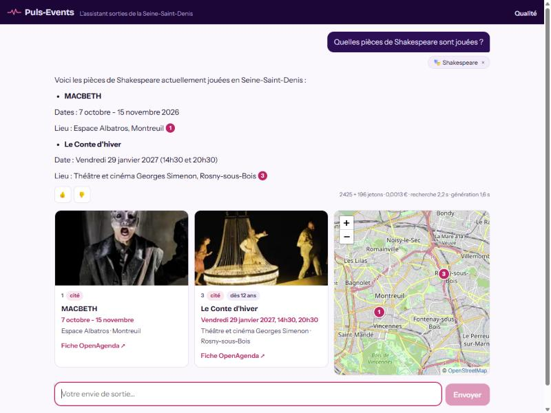
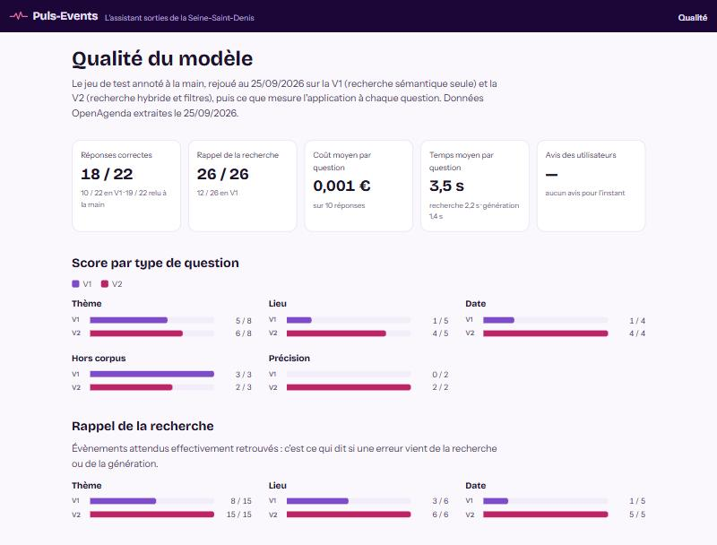

# Rapport technique — Assistant RAG Puls-Events

**Recommandation d'évènements culturels en Seine-Saint-Denis**

Mathieu Zinzen, Data Engineer — novembre 2026

## 1. Contexte

Puls-Events veut savoir si un chatbot peut recommander des évènements culturels en langage naturel
(« un spectacle de marionnettes pour mon fils ? », « que faire le 21 juin ? ») sans inventer
d'évènements. Ce POC répond avec un système RAG : les évènements pertinents sont retrouvés dans un
index Faiss, puis un modèle Mistral rédige la réponse, le tout orchestré par LangChain.

Contraintes de l'énoncé : données OpenAgenda sur un périmètre géographique et de moins d'un an, base
vectorielle reconstructible par scripts, tests de qualité des données dans un pipeline, jeu de test
annoté, pas d'historique de conversation.

Code : `github.com/Matz-ai/concevoir-et-deployer-un-systeme-rag`.

## 2. Architecture

```
HORS LIGNE (reconstruction à la demande)
  OpenAgenda ─► extract.py ─► preprocess.py ─► build_index.py ─► Faiss + métadonnées
                4 569 bruts    2 295 propres    chunks + mistral-embed
                                     ▲
                               pytest + GitHub Actions

EN LIGNE (une question)
  question ─► Mistral lit les filtres ─► BM25 + Faiss filtrés ─► Mistral Large ─► réponse + sources
              (ville, dates, âge, thème)   10 chunks
```

| Script | Rôle |
| --- | --- |
| `extract.py` | interroge l'API OpenAgenda et écrit les évènements bruts |
| `preprocess.py` | nettoie, structure, compte ce que chaque règle écarte |
| `build_index.py` | découpe, vectorise et construit l'index Faiss |
| `rag.py` | la chaîne : filtres, recherche, génération |
| `chat.py` | démo en ligne de commande (l'interface web passe par `api/main.py`) |
| `evaluate.py` | rejoue le jeu de test annoté et mesure la qualité |

Les trois scripts hors ligne reconstruisent l'index en quelques minutes pour environ 0,10 $. Aucune
donnée n'est versionnée, seulement le code.

## 3. Les données

**Périmètre.** Jeu open data `evenements-publics-openagenda`, sans clé. La Seine-Saint-Denis : assez
d'offre culturelle pour que la recherche ait du sens, assez peu pour reconstruire l'index pendant une
démo. Les filtres département et date sont appliqués par l'API, car elle refuse de paginer au-delà de
10 000 résultats. Résultat : 4 569 évènements.

**Nettoyage.** On garde 12 champs sur 56, puis six règles s'appliquent dans l'ordre :

| Règle | Écartés |
| --- | --: |
| Agenda France Travail (ateliers CV, entretiens) | 2 146 |
| Description inexploitable (moins de 30 caractères) | 83 |
| Doublon même titre, date et lieu | 43 |
| Annulé | 2 |
| Hors 93 ou commencé il y a plus d'un an (double contrôle) | 0 |
| **Restent** | **2 295** |

La découverte la plus utile est venue de l'exploration : près de la moitié du brut était des ateliers
France Travail. Sans cette règle, « un atelier pour enfants » remontait des ateliers de CV. On garde
aussi la plus longue des deux descriptions et on retire le HTML.

**Tests.** `test_data_quality.py` vérifie ce qui part dans l'index : périmètre, moins d'un an,
pas de doublon, champs obligatoires remplis. Chaque test tourne sur un échantillon écrit dans le
fichier (qui contient une violation de chaque règle) et sur le vrai dataset s'il existe. La CI GitHub
Actions n'a ni clé ni données : elle vérifie l'échantillon, et que l'environnement se réinstalle. Le
test « moins d'un an » échoue quand le dataset local vieillit : c'est voulu, il faut alors relancer le
pré-processing.

## 4. Choix techniques

**Texte vectorisé.** Titre, mots-clés, lieu, ville, dates et description. Sans le lieu, le même
spectacle à Montreuil et à Bobigny aurait le même vecteur. Les mêmes champs sont gardés en métadonnées
pour filtrer et afficher les sources.

**Chunks.** 1 000 caractères avec 100 de recouvrement : 74 % des évènements tiennent en un seul
chunk, seules les longues programmations sont coupées. 2 295 évènements donnent 3 860 vecteurs.

**Modèles.** `mistral-embed` (1 024 dimensions) et `mistral-large-2512` à température 0, appelés via
OpenRouter, une passerelle compatible OpenAI pour laquelle j'avais déjà une clé. Passer à l'API
Mistral directe ne demande que de changer l'URL.

**Index.** `IndexFlatL2`, recherche exacte : quelques millisecondes pour 3 860 vecteurs, 16 Mo. Les
vecteurs Mistral sont normés, donc L2 classe comme le cosinus. Les index approximatifs (IVF, HNSW)
ne deviennent utiles qu'à partir de centaines de milliers de vecteurs.

**La chaîne.** Ce n'est pas un agent : chaque question suit toujours les mêmes trois étapes.

1. *Lecture de la question.* Un appel Mistral en sortie structurée remplit ville, dates, âge et
   thème. « Ce week-end » devient deux dates réelles. Si rien n'est lu (« un truc sympa ? »),
   l'assistant demande une précision au lieu de répondre au hasard.
2. *Recherche hybride.* BM25 cherche les mots exacts du thème, Faiss cherche le sens, et
   l'`EnsembleRetriever` fusionne les deux classements. Les filtres s'appliquent aux métadonnées,
   et les évènements déjà terminés sont toujours écartés. On garde 10 chunks.
3. *Génération.* La consigne impose de répondre seulement avec les évènements fournis, de citer
   chacun par son numéro, et de dire franchement quand rien ne convient.

La date est filtrée par le code et non confiée au modèle : quand on lui demandait d'ignorer les
évènements passés, il ne le faisait pas toujours.

**Pourquoi LangChain.** L'énoncé l'impose, mais il apporte surtout des composants déjà testés que
je n'ai pas eu à écrire : BM25 et la fusion des classements, la sortie structurée validée par
Pydantic, les nouvelles tentatives sur les erreurs 429, le streaming et le comptage des jetons. C'est
aussi un standard connu : une équipe qui reprend le projet le lit sans documentation.



## 5. Évaluation

**Protocole.** 22 questions annotées à la main à partir d'évènements réellement indexés : 8 par
thème, 5 par lieu, 4 par date, 3 hors corpus (un match du PSG, la météo…) et 2 trop vagues. Le critère
de l'énoncé, « même sens et mêmes informations », est appliqué par un juge Mistral qui rend CORRECT ou
INCORRECT. La comparaison exacte refuse les reformulations, les mots-clés ne lisent pas un « non », et
la similarité ne vérifie ni une date ni un lieu. En parallèle, sans LLM, on mesure le **rappel** : la
part des évènements attendus présents dans les chunks récupérés. C'est ce qui dit si une erreur vient
de la recherche ou de la génération.

**Résultats.** La première version n'utilisait que Faiss. Les deux versions sont rejouées à la même
date de référence :

| Type | Correctes, Faiss seul | Hybride + filtres | Rappel, Faiss seul | Hybride + filtres |
| --- | :-: | :-: | :-: | :-: |
| Thème | 5 / 8 | 6 / 8 | 8 / 15 | 15 / 15 |
| Lieu | 1 / 5 | 4 / 5 | 3 / 6 | 6 / 6 |
| Date | 1 / 4 | 4 / 4 | 1 / 5 | 5 / 5 |
| Hors corpus | 3 / 3 | 2 / 3 | — | — |
| Trop vague | 0 / 2 | 2 / 2 | — | — |
| **Total** | **10 / 22** | **18 / 22** | **12 / 26** | **26 / 26** |

**Analyse.**

- **La première version échouait à la recherche.** Les concerts de jazz sortaient aux rangs 114 et
  388, car « jazz » n'était que dans leurs mots-clés. Et un vecteur ne sait pas ce qu'est « le 13
  décembre ». BM25 et les filtres corrigent exactement ces deux cas.
- **Le maillon faible est maintenant la génération.** Pour le jazz, les deux concerts sont dans le
  contexte, mais le modèle n'en cite qu'un.
- **La mesure a ses limites.** J'ai relu chaque verdict à la main : 19 / 22, car la météo est un refus
  correct que le juge trouve trop court. Un rejeu redonne 18 / 22, mais quatre verdicts changent :
  il faut comparer des tendances. Le réglage BM25 a été choisi sur ce même jeu, il faudra le vérifier
  sur de nouvelles questions.
- **Le jeu vieillit.** Les évènements attendus finissent par être passés. La variable
  `DATE_REFERENCE` rejoue le jeu à sa date d'origine, mais il faudra en annoter de nouveaux.

**Coût.** Environ 0,001 € et 3,5 s par question (deux appels Mistral), mesurés sur une dizaine de
questions de test : c'est un ordre de grandeur. L'interface web affiche ces chiffres sur une page
Qualité, avec les avis des utilisateurs.



## 6. Limites et recommandations

| Priorité | Recommandation | Pourquoi |
| :-: | --- | --- |
| 1 | API Mistral directe avec quota dédié | le pool partagé d'OpenRouter renvoie des erreurs 429 |
| 1 | Mise à jour quotidienne et incrémentale | les évènements changent tous les jours ; le `uid` permet de ne revectoriser que le nouveau |
| 2 | Rejeu hebdomadaire du jeu de test, avec alerte | détecter une baisse après un changement de données, de prompt ou de modèle |
| 2 | Suivre les avis, les réponses « rien ne correspond » et la fraîcheur de l'index | dérive des usages, extraction qui échoue sans bruit |
| 3 | Base vectorielle (Qdrant ou pgvector) à l'échelle nationale | Faiss ne filtre pas nativement et n'est pas une base : pas de mise à jour concurrente ni de réplication |

Le POC fonctionne de bout en bout : données propres et testées, index reconstructible, réponses qui
citent leurs sources et refusent d'inventer. L'évaluation a d'abord montré que la recherche était le
problème, puis mesuré l'effet de la correction. C'est elle qui guidera les prochaines améliorations.
